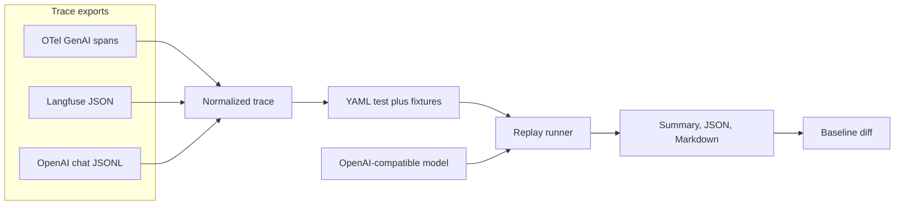

# trace2test

Changing a prompt, a model, or a tool definition can quietly change what an agent does. The unit tests you wrote against the happy path do not catch it, because the interesting behavior is sitting in old production sessions: which tool it called, which arguments it chose, and what it said after the tool came back.

trace2test turns those sessions into regression tests. You point it at a trace export, it writes a YAML case per session, and `trace2test run` replays the session against any OpenAI-compatible endpoint. Tools are not called again. They return the results they returned in the original trace, so the diff is about the model and the prompt, not about the world having moved.

## Quick start

Node 20 or newer.

```bash
npm install
npm run build

# The repo already has sample traces. This records the OpenAI one again.
npx tsx examples/demo-agent/agent.ts --scripted --out examples/traces/openai-chat.jsonl

npx trace2test generate examples/traces --out examples/tests

# Terminal 1: a local model that follows the same script as the samples.
npx tsx examples/demo-agent/agent.ts --serve

# Terminal 2
npx trace2test run examples/tests \
  --model gpt-4o-mini \
  --base-url http://127.0.0.1:8787/v1 \
  --api-key local
```

Against a real endpoint, set `OPENAI_API_KEY` (or `TRACE2TEST_API_KEY`) and drop `--base-url`. `OPENAI_BASE_URL` / `TRACE2TEST_BASE_URL` override the default `https://api.openai.com/v1`.

```bash
npx trace2test run examples/tests --model gpt-4o-mini
npx trace2test run examples/tests --model gpt-4.1-mini --baseline trace2test-results/results.json
```

A run writes a summary on stdout, plus `trace2test-results/results.json`, `report.md`, and a shorter `summary.md` for CI job pages. With `--baseline`, the process exits 1 when a test that used to pass now fails, which is the check you want in CI. Failures that were already failing are reported and do not fail the job.

## Architecture



Replay stubs every tool from the fixture list. The model is the only live dependency.

```mermaid
sequenceDiagram
  participant Runner
  participant Model
  participant Fixtures
  Runner->>Model: original input and tool definitions
  Model-->>Runner: tool call
  Runner->>Fixtures: match name and key arguments
  Fixtures-->>Runner: recorded result
  Runner->>Model: tool result
  Model-->>Runner: final answer
  Runner->>Runner: score sequence, answer, tokens, latency
```



The test prompt is the input of the first model call. Later calls in the trace are how the tool transcript is reconstructed, not extra prompts.

## A generated test

`trace2test generate` writes one file per trace. `examples/tests/weather-in-paris.yaml` came from the OTel sample. The `recorded` block (model, tokens, duration) is omitted here.

```yaml
id: weather-in-paris
name: Weather in Paris?
source:
  format: otel
  id: 4bf92f3577b34da6a3ce929d0e0e4736
  file: otel-genai.json
input:
  messages:
    - role: system
      content: You are a weather assistant. Use get_weather before answering.
    - role: user
      content: Weather in Paris?
  tools:
    - name: get_weather
      description: Get the current weather in a city
      parameters:
        type: object
        properties:
          location:
            type: string
            description: City name
        required:
          - location
fixtures:
  - id: call_weather_paris
    name: get_weather
    arguments:
      location: Paris
    result: rainy, 57°F
    match: subset
assertions:
  toolSequence:
    mode: ordered
    expected:
      - name: get_weather
        arguments:
          location: Paris
        match: subset
  finalAnswer:
    - type: regex
      pattern: 57\s*°\s*F
      flags: i
    - type: contains
      value: Paris
  judge:
    enabled: false
    rubric: |-
      The assistant was asked: Weather in Paris?
      It should take the same kind of action as the recording: get_weather(location="Paris").
      The answer should stay consistent with the recorded outcome, including: 57°F, Paris.
      Wording can differ. The facts, the tool choice, and whether the request was answered cannot.
    minScore: 0.7
```

The generated file is a draft. Delete checks you do not care about and tighten the ones you do. `match: subset` requires the recorded keys and allows the model to send extras. `match: exact` compares the whole argument object. `match: any` only checks the tool name. `toolSequence.mode: ordered` requires the expected calls as an in-order subsequence. `exact` also rejects extra calls.

Final-answer checks are chosen from the recorded output:

| Recorded output | Check |
| --- | --- |
| JSON object or array | JSON Schema derived from the value. Short strings, numbers, and booleans are pinned with `const`. |
| Prose with dates, amounts, units, or names | `contains`, or a `regex` when the fact has a unit or a symbol (`57°F`, `$25.00`) |
| A very short literal | `exact` |

`generate --judge` sets `judge.enabled: true`. A rubric then runs on every `trace2test run`. `run --judge` scores every rubric, including ones left disabled. The judge must return `{"score": 0.0-1.0, "reason": "..."}` and passes at `minScore` (default 0.7).

## Example report

This is a real run of `examples/tests` against the demo server. Latency is the local round trip. Cost is estimated from the token usage the server reported and the built-in price table (USD per 1M tokens, list-price approximations; override with `--prices`).

```text
trace2test  gpt-4o-mini  3 tests

  PASS  order-and-balance  tools 1.00     32ms  $0.000155
  PASS  order-status       tools 1.00     23ms  $0.000099
  PASS  weather-in-paris   tools 1.00      3ms  $0.000099

3 tests, 3 passed, 0 failed, 0 errors, 58ms, $0.000353

results  trace2test-results/results.json
report   trace2test-results/report.md
```

`report.md` starts like this:

```markdown
# trace2test report

- Model: `gpt-4o-mini`
- Result: 3/3 passed, 0 failed, 0 errors
- Latency: 58ms
- Tokens: 1560 in / 198 out
- Estimated cost: $0.000353

| Test | Status | Tool similarity | Latency | Cost |
| --- | --- | ---: | ---: | ---: |
| order-and-balance | pass | 1.00 | 32ms | $0.000155 |
| order-status | pass | 1.00 | 23ms | $0.000099 |
| weather-in-paris | pass | 1.00 | 3ms | $0.000099 |
```

Each test section lists every assertion, the final answer, and, on failure, the expected and actual tool calls. `results.json` is the machine-readable form and the file you pass back as `--baseline`.

A failure that is new relative to the baseline is a regression and the process exits 1:

```text
  FAIL  weather-in-paris   tools 1.00      3ms  $0.000099
        - did not match /999\s*°\s*F/

baseline trace2test-results/results.json (gpt-4o-mini)
  REGRESSION  weather-in-paris  did not match /999\s*°\s*F/
```

| Situation | Exit code |
| --- | --- |
| Every test passed | 0 |
| Any test failed or errored, and there is no baseline | 1 |
| Baseline present, no new failures | 0, including known failures |
| Baseline present, a previously passing test now fails, or a new test fails | 1 |
| `--fail-on-score-drop` and tool-sequence similarity fell | 1 |

Tool-sequence similarity is `matched / max(expected, actual)` with in-order matching. Both empty is 1. Score moves are printed either way; only `--fail-on-score-drop` turns a drop into a failing exit.

`--repeat 5` runs every case five times. A case that both passes and fails in that set is marked flaky in the terminal output, `report.md`, and `summary.md`. It counts as a failure, so CI goes red. A case that fails every time is a normal failure, not a flake.

## GitHub Action

`action.yml` is a composite action. Build the CLI first (`npm ci && npm run build`); the action runs `dist/cli.js`. It replays the YAML cases, appends `summary.md` to the job summary, and uploads `report.md` and `results.json` as an artifact. The step fails when the CLI exits non-zero: any failure without a baseline, or a new failure when `baseline` points at a previous `results.json`.

Copy `examples/workflows/trace2test.yml` to `.github/workflows/` and point `baseline` at a known-good `results.json`. Set `OPENAI_API_KEY` in the job environment. `repeat` is optional and defaults to 1.

## Pytest

Python is optional. The core tool stays TypeScript. `trace2test export` writes a single pytest module that replays the same fixtures and assertions against `OPENAI_BASE_URL`:

```bash
npx trace2test export examples/tests --format pytest --out examples/pytest/test_agent_sessions.py
OPENAI_BASE_URL=http://127.0.0.1:8787/v1 OPENAI_API_KEY=local pytest examples/pytest/test_agent_sessions.py
```

The checked-in module is that export. It needs pytest and nothing else. Judge rubrics are not translated; run those with `trace2test run --judge`.

## Trace formats

`generate` detects the format per file. Pass `--format otel|langfuse|openai` when a file is ambiguous.

**OpenTelemetry GenAI.** OTLP JSON (`resourceSpans` / `scopeSpans`) and a flat span list. Attribute keys may be camelCase or snake_case, and values may be OTLP `AnyValue`s or already-decoded JSON. Messages are read from `gen_ai.input.messages` and `gen_ai.output.messages` (the parts model: `text`, `tool_call`, `tool_call_response`), from span events, or from the older indexed `gen_ai.prompt.*` / `gen_ai.completion.*` attributes. `execute_tool` spans contribute tool name, call id, and, when present, `gen_ai.tool.call.arguments` and `gen_ai.tool.call.result`. Usage accepts both `gen_ai.usage.input_tokens` and `gen_ai.usage.prompt_tokens`. Provider accepts `gen_ai.provider.name` and `gen_ai.system`.

**Langfuse.** A UI download (`{ trace, observations, scores }`) or a trace object with an `observations` array. `GENERATION` observations become model calls. Inputs may be a message list, `{ messages, tools }`, or a string. Outputs may be an assistant message, a chat-completion body, a string, or a plain JSON object. `TOOL` observations fill arguments and results when the message list does not already contain them. Usage accepts `promptTokens` / `completionTokens` and `input` / `output`.

**OpenAI chat logs.** JSONL, a JSON array, or one JSON object. Each record is a `{ request, response }` pair (`body` and `completion` are accepted aliases). A file is one session unless records set `trace_id` or `session_id`. Optional `name`, `timestamp`, and `latency_ms` are picked up. The client is assumed to resend the growing message list, which is how tool results are recovered.

## Demo agent

`examples/demo-agent/agent.ts` is a support agent with three tools: `lookup_order`, `get_balance`, and `get_weather`. It has two modes that do not need a key:

- `--scripted` runs the fixed policy and writes an OpenAI JSONL trace.
- `--serve` listens on `127.0.0.1:8787` (override with `--port`) and answers the three sample tasks the same way, so the checked-in tests pass offline.

With `OPENAI_API_KEY` set and no `--scripted` flag, it calls a real model, runs the tools locally, and writes a trace you can generate tests from.

| Sample | Format | What it covers |
| --- | --- | --- |
| `examples/traces/otel-genai.json` | OTel spans | One tool, prose answer |
| `examples/traces/langfuse.json` | Langfuse export | One tool, JSON answer |
| `examples/traces/openai-chat.jsonl` | Chat-completions log | Two tools, prose answer |

## CLI

```text
trace2test generate <traces...> --out <dir> [--format otel|langfuse|openai] [--judge]
trace2test export <tests> --format pytest --out <file>
trace2test run <tests> --model <id>
  [--base-url <url>] [--api-key <key>] [--out <dir>]
  [--baseline <results.json>] [--judge] [--judge-model <id>]
  [--max-steps <n>] [--repeat <n>] [--fail-on-score-drop] [--prices <file>]
```

`--max-steps` defaults to 8. A test that is still calling tools at the limit fails. A tool call that matches no fixture is returned to the model as an error and fails the test. Replay sends `temperature: 0`.

`--prices` is a JSON object of `{ "<model>": { "input": <usd per 1M>, "output": <usd per 1M> } }`, merged over the built-in table. Dated snapshots such as `gpt-4o-mini-2024-07-18` use the longest matching entry. Unknown models report cost as `n/a` and do not pretend the total is complete.

The same operations are importable: `ingestPaths`, `writeTestCases`, and `runSuite`.

## Development

```bash
npm run lint
npm run typecheck
npm test
npm run build
```

Tests use a scripted model and the demo server. They do not call a hosted API. One test runs the exported pytest module, so CI installs pytest first. The Node checks are lint, typecheck, test, and build on Node 20 and 22.

## Roadmap

- Import LangSmith and Arize Phoenix traces.

## License

MIT. See [LICENSE](LICENSE).
